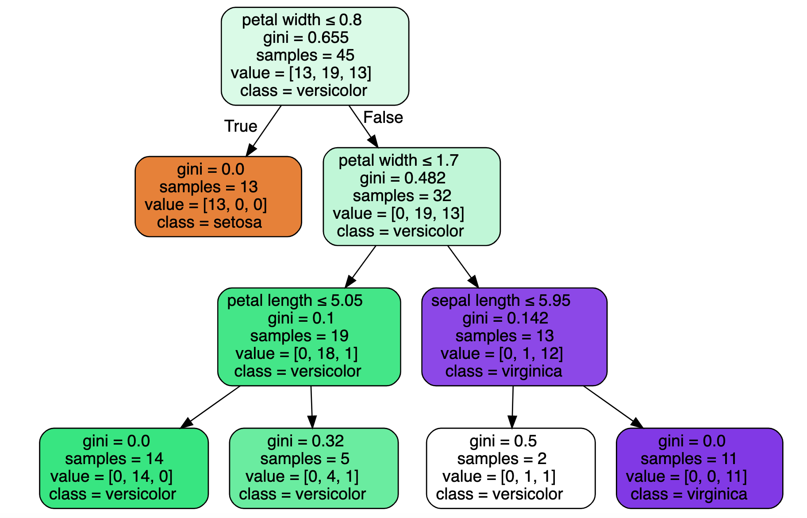
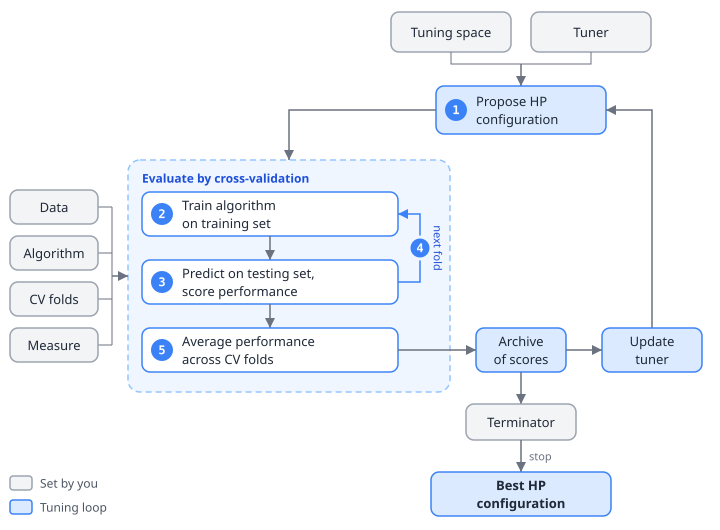
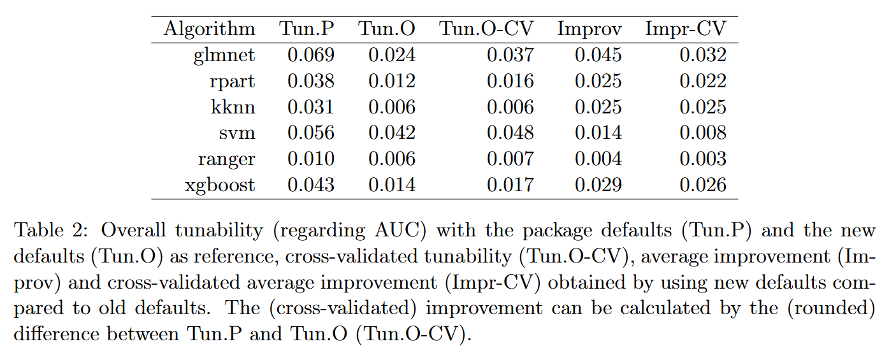
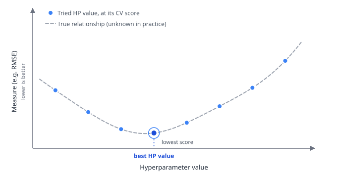
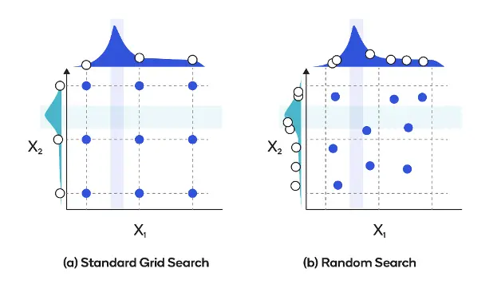
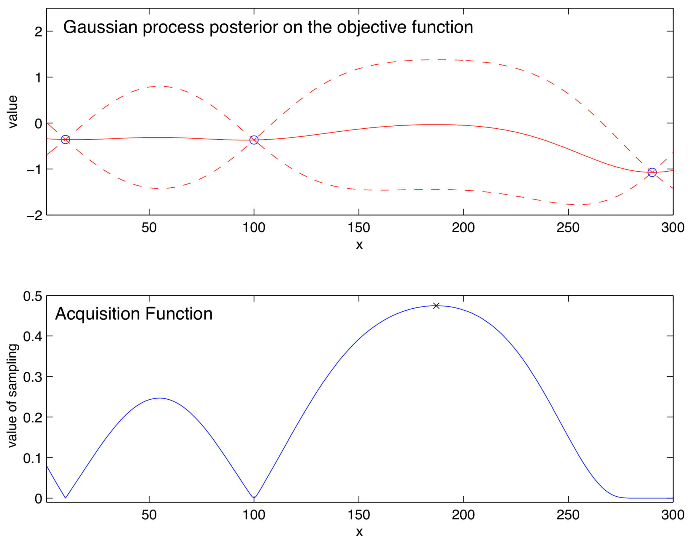
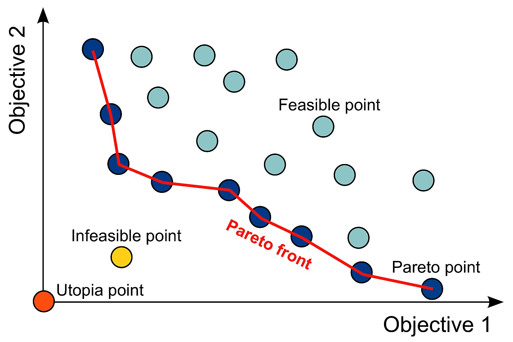
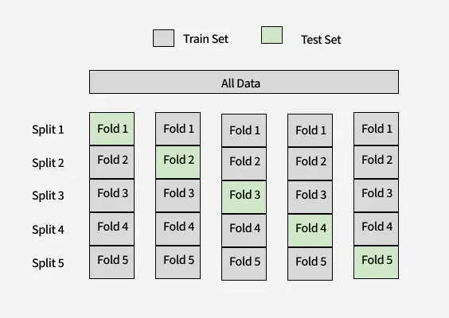

# Machine Learning

## Setting the record straight

Here, "Machine Learning" (ML) refers to the _algorithms_, e.g. Random Forest, Support Vector Machine. When the algorithms are trained on a dataset, it is called a _model_, or _ML model_.

$$
\text{ML algorithm} + \text{Data} = \text{ML model}
$$

The ML models are then used for whatever purpose it is trained for, e.g. classifications, forecasting, regression.

## Hyperparameters

All models, ML or not, have **parameters** which are quantities that are summarised across a population/data, and describes that population/data. In the field of ML, the parameters are learned "automatically". _How_ it learns is defined by the algorithm and **hyperparameters** (HPs).

An algorithm can have anywhere from 1 to 10 (or more!) tunable[^t] HPs, though, not all HPs have the same impact to the algorithm's training and prediction performance[^bischl2021]. A set of HPs is called a **configuration**. All ML algorithms come with a default HP configuration, which are typically set by the package or library that you use, e.g. `tidymodels`, `mlr3`, Python's `scikit-learn`.

Example: For a Decision Tree model, what are parameters and what are hyperparameters?

Reveal

- Parameters: split conditions
- HPs: max tree depth, split conditions, minimum split size

# Hyperparameter optimisation

## HPO basics

Hyperparameter optimisation (HPO; also called hyperparameter tuning, hypertuning, model tuning) is the act of finding the best HP configuration for the given dataset to results in best model prediction performance and generalisability.

HPO can be though of as a looping sequence, requiring:

- **Tuner**: The tuning strategy
- **Tuning space** or **search space**: The domain of the HPs
- **Measures**: How do you score the performance of a set of HPs?
- **Terminators**: When do you stop tuning? (and take the best values)

You would typically want to test each HP configuration with cross-validation[^cv]. The point is to make sure that you are selecting an HP configuration that is not overfitted to any set of training data. The flow is as follows:

::: scrolly

<figure>

<!-- <figcaption>The HPO loop, with cross-validation as the evaluation step. Adapted from Figure 4.1 of Becker et al. (2024). <a href="https://mlr3book.mlr-org.com/chapters/chapter4/hyperparameter_optimization.html"><em>Hyperparameter Optimization</em></a>. In <em>Applied Machine Learning Using mlr3 in R</em>. Licensed under <a href="https://creativecommons.org/licenses/by-nc-sa/4.0/">CC BY-NC-SA 4.0</a>.</figcaption> -->
</figure>

The whole loop at a glance.

The grey boxes are set by you before the tuning starts; the blue boxes are what happens in each round of the loop

{highlight="tuning-space tuner propose"}
**Proposing a configuration** The _tuner_ picks an HP configuration from the _tuning space_. How and what it picks depends on the tuner's strategy (we'll get there)

{highlight="inputs cv"}
**Config evaluation** The configuration goes to cross-validation, together with the data, the algorithm, the CV scheme, and the measure(s).

{highlight="train"}
**Config evaluation: Train.** The algorithm is trained on the training set, with the proposed configuration.

{highlight="predict"}
**Config evaluation: Predict and score.** The trained model predicts the testing set, which it did not see in training. The measure (e.g. RMSE) scores the predictions.

{highlight="next-fold train predict"}
**Config evaluation: Next fold.** Steps 2 and 3 repeat for each fold. With $k$-fold CV, each configuration trains $k$ models and gets $k$ scores.

{highlight="average"}
**Config evaluation: Average.** The $k$ scores are averaged into one score. This is the estimate of how well the configuration does on data that the model has not seen. (this aggregator can be anything you want, e.g. mean, min, max, median)

{highlight="archive"}
**Archive.** The configuration and its score go into an archive, which holds the history of every configuration tried so far.

{highlight="update"}
**Update the tuner.** The tuner learns from the archive and proposes the next configuration, and the loop starts again at step 1.

{highlight="archive terminator"}
**Stop?** After each round, the terminator checks the archive: has the tuning used up its budget (e.g. 100 evaluations, or 1 hour), or has the best score stopped improving for the past 10 evaluations? If not, the loop goes on.

{highlight="result"}
**Result.** When the terminator stops the tuning, the configuration with the best score in the archive is the result. The final model is then trained on all the data, with this configuration.

:::

## Do we really need to do this?

HPO is typically the most computationally heavy, complex, and time-consuming part of an ML workflow, and the results are... not always worth it. This begs the question: "Do we really need to do this?"

The answer is, as a good friend of mine would say:

> **"It depends"**
>
> -- Prof. Ronald B. Geskus, circa 2026

Probst et al. (2018)[^probst2018] tackled this problem by setting a large-scale benchmarking study, using 38 datasets and 6 common ML algorithms, to understand the overall impact of HPO on ML algorithms and find out if it's worth the effort to do so. The study also propose a list of optimised default values and suggested search space for each HP.

The overall results can be seen in Table 2 of the preprint (and below):

We can see that _it depends_ on the ML algorithm. `ranger`, a Random Forest implementation, improved the least with HPO. `svm`, Support Vector Machine, is slightly better, but also lowers in average improvement when cross-validated.

I would also expect that these scores will also vary by different datasets, as this study only uses binary classification as the modelling target. Their tuning strategy (uniform random sampling) also leaves much to be desired. A smarter, more informed tuner might be better at searching for the best HP configuration.

## HPO tuners

### Grid search and random search

If you only want to tune 1 HP, you just need to search the (HP) x (measure) space, find which HP would result in the lowest/highest measure.

If you have 2 HPs, you then search the 2-dimensional space of the HPs. Typically, we would use _grid search_ or _random search_.

What do you do when you have 3 or more HPs? You can do the same grid search and random search strategy. The multi-dimensional space you're search now is called a **hypervolume**[^hv].

### Evolution Strategies

I'm not an expert in this one so I'll keep it simple.

Evolution Strategies are stochastic tuners that, initially, (1) propose a set of HP configurations, (2) score them and pick promising candidates as "parents", (3) selected configurations are crossed-over or mutated into "offsprings", then repeat steps 2 and 3 until the terminator halts the loop, you know the drill.

### Bayesian Optimisation

Bayesian Optimisation (BO) is becoming increasingly popular as the be-all and end-all HPO tuner.

The idea is: we treat HPO as a black-box problem (which it is), and for any black-box problem, you can use a surrogate model[^surrmod] to estimate the hidden process, i.e. the black-box. BO most commonly uses Gaussian Process as the surrogate model[^surrmod2], providing a Bayesian posterior that can describe potential gain or loss of performance for each set of HP configuration. A BO tuner has 2 main components: the surrogate model, and the **acquisition function**

The **acquisition function**'s job is to read the current states of the surrogate model, and propose the next point to sample (sounds like MCMC doesn't it?). The beauty of an acquisition function lies in its decision to either **explore or exploit**. What is the acquisition function in the figure above?

Reveal

It's probably an UCB (Upper Confidence Bound) function, sampling the highest upper-bound value of the surrogate's confidence bounds. This is a good idea for measures where you want to maximise.

Conversely, if your goal is to minimise (i.e. error scores such as RMSE), then you would use LCB (Lower Confidence Bound) as the acquisition function

<figure class="bo-demo">
<noscript>This demo needs JavaScript.</noscript>
<figcaption>BO of one HP, with a GP surrogate and LCB as the acquisition function. The loop starts from 3 HP values, then runs 30 iterations. In each iteration, the tuner evaluates the HP value where the LCB is lowest, adds its CV RMSE to the archive, and updates the GP. Press Play, or drag the slider.</figcaption>
</figure>

Some common acquisition functions:

- UCB/LCB
- Probability of Improvement
- Expected Improvement (EI; similar to the above but factor in the magnitude instead of just probability)
- Expected Hypervolume Improvement (EHVI; EI but in hypervolume)

Hmm, what is EHVI? Well, in some cases, you would actually want to have more than one measure/metric to optimise for. Then, the acquisition function needs to take into account the improvement across different axes, rather than just one. Most of the time, the gain in one measure would be a loss in the other measure, making it difficult to really sample and select the "perfect" HP configuration. This leads to us...

# The Pareto Front

## Searching for utopia

The Pareto Front (or Pareto frontier) is a set of solutions where no one solution strictly out-performs any other. Both axes of the Pareto Front should have the same direction. The theoretical best point on this space is called the **utopia point**.

The point is not to find the utopia point, but to try and push the frontier towards that point.

## Adversarial measures

I previously mentioned that: "the gain in one measure would be a loss in the other measure". Well, this depends on the measures you choose. If you chose 2 measures that are both

## Pushing the frontier

# Conclusions

# Appendix

## The initial design for BO

The initial design is typically generated using Latin Hybercube Sampling (LHS) or Sobol sequence

LHS is near-random sampling for multidimensional space

Sobol is a space-filling design, i.e. it tries to minimise empty space and clumping, generate a quasi-random (uniformly distributed) sequence

---

AI disclosure: Claude Opus 5.5 was used to help build the blog post, namely, the underlying source code, blog post framework, animations, and SVG. The content, flow, and most text are human-made.

[^t]: Tunable/Tune-able means that the hyperparameter is not fixed and can be defined on a domain

[^cv]: A simple example is k-fold cross-validation, and this figure should be very self-explanatory 

[^bischl2021]: Bischl et al. (2021). _Hyperparameter Optimization: Foundations, Algorithms, Best Practices and Open Challenges_. <https://arxiv.org/abs/2107.05847>

[^probst2018]: Philipp Probst and Bernd Bischl and Anne-Laure Boulesteix (2018). _Tunability: Importance of Hyperparameters of Machine Learning Algorithms_. <https://arxiv.org/abs/1802.09596>

[^hv]: Any volume with more than 3 dimensions is called a hypervolume

[^surrmod]: A surrogate model is a model that approximates the true model, and is often of much less complexity than the true model

[^surrmod2]: Another common option is Random Forest
